# Rafeeq · رفيق


> **Every teacher sees. Every student understands.**

An Arabic-first AI learning companion that connects teachers, students and parents around the teacher's own material. Arabic is the default, with an English toggle. Built as an NTI AI capstone project (Education domain, team of 5).

*Rafeeq* means "companion". Each class gets one shared room. AI agents answer only from the teacher's own slides and books, and the teacher stays in charge of what students receive.

## The problem

One teacher cannot see thirty minds at once. Egypt has about 25.8M students in school and 1.26M teachers. Teachers spend around 12 hours a week on planning and marking, and up to 75% of final-year secondary students pay for private tutoring. Struggling students stay invisible until the exam, and families pay to fill the gap. *(Sources: UNESCO GEM / World Education Blog 2025; OECD TALIS; World Bank via Egyptian Streets 2026.)*

## What Rafeeq does

Rafeeq combines a RAG tutor grounded in the course material, a student-modeling layer that predicts weak topics, agents for planning, quizzing and reporting, handwriting/photo recognition with hints (Snap & Ask), and a teacher dashboard.

| For | Features |
|---|---|
| **Students** | Cited answers · handwriting check with one hint at a time · quizzes that come back after 1, 7 and 30 days · a "what to do next" plan |
| **Teachers** | See who is struggling and on which topic · one-click lesson studio (slides, code examples, quiz; the teacher approves before anything is built) · AI-drafted replies for approval |
| **Parents** | A weekly Arabic report by private link, written from fixed templates so nothing is invented |

### Weekly loop

1. **Upload**: the teacher adds slides and books to the class room.
2. **Understand**: Rafeeq reads and indexes every page, in Arabic and English.
3. **Learn**: students ask, snap their work and take quizzes.
4. **Detect**: Rafeeq tracks each student's weak topics.
5. **Act**: the teacher drafts a review lesson in one click.
6. **Inform**: parents receive a clear weekly report.

Steps 3 to 6 repeat every week.

### Feature list

- **Ask**: a tutor that answers only from the room's own material, with page citations, in Arabic or English. If the answer is not in the material it says so.
- **Snap & Ask**: photograph a question or your own worked solution; a vision-language model reads it and the tutor answers or checks it.
- **Quiz**: generated per topic, graded automatically, feeding back into the student's profile.
- **My plan**: a "what to do next" suggestion based on weak topics.
- **Rooms**: a course room per teacher, with student uploads and (proposed) a personal study room with no teacher.
- **Teacher dashboard**: class-wide insights, a per-topic report, and an assistant that drafts replies for approval.
- **Lecturer studio and parent reports**: slides, code examples and a quiz drafted for teacher approval; a weekly parent summary.
- **Video, voice and images** (in testing): story videos, narration and image editing for lessons.

## Stack

FastAPI + Jinja2 + HTMX (one server-rendered app, no separate frontend build), LangGraph agents, Postgres with pgvector, Docker for local development, deployed on Render. Dependencies are managed with [uv](https://docs.astral.sh/uv/).

**Models.** Every model is called through a configurable provider, so any of them can be swapped.

| Role | Local development default | Hosted configuration |
|---|---|---|
| Tutor answers | Ollama `qwen3:8b` | Gemini 3.5 Flash-Lite |
| Router, Snap, quiz, lessons | Ollama `qwen3:8b` | Qwen 27B (Groq) |
| Handwriting reader | `qwen2.5vl:7b` (or Gemini) | vision model via `SNAP_READER` |
| Search and reranking | bge-m3 (local) + FAISS + BM25 | same |
| Web search (Level 2) | Tavily | Tavily |
| Story video / voice | n/a | Wan 2.6 (720p) / edge-tts |

## Run it locally

```bash
uv sync --extra knowledge          # the knowledge extra adds the embedder (bge-m3) and FAISS
copy .env.example .env             # macOS/Linux: cp .env.example .env ; then put your Groq key in LLM_API_KEY and GROQ_API_KEY
docker compose up -d db            # optional: keeps the teacher data across restarts
uv run uvicorn rafeeq.main:app --reload
```

Open http://127.0.0.1:8000 — you should see the Arabic home page. The first PDF upload downloads the embedder (about 2.3 GB), so the first indexing takes a few minutes.

Check every part end to end (while the server runs, in a second terminal):

```bash
uv run python -m rafeeq.copilot.check_llm      # the hosted model answers, routes and reads images
uv run python scripts/smoke_check.py           # teacher, student, room, PDF, Copilot, quiz, Snap, teacher reports
```

The second command prints PASS / WARN / FAIL for each step and saves `results/smoke_check.json`.

**With Docker** (also starts Postgres):

```bash
docker compose up --build
```

## How it is built

One app, one router, specialised agents:


### Modules

| Module | Responsibility |
|---|---|
| **M1 — Copilot & UI** | User-facing interface; routes each message (keywords, then LLM, then rules) to ask / check work / quiz / plan / clarify |
| **M2 — Knowledge & RAG** | Content indexing, hybrid retrieval (bge-m3 + FAISS + BM25), grounded answers |
| **M3 — Tutor & Snap** | Guided tutoring, citations, uncertainty checks, handwritten-work analysis |
| **M4 — Quiz & Student Profile** | Quiz generation and grading, learning events, student profile, review data |
| **M5 — Teacher Tools** | Dashboard, class insights, reports, teacher-approved replies |

`contracts/openapi.yaml` and `contracts/samples/` define every route and JSON shape between modules.

## System architecture and deployment

### High-Level Architecture

**Architecture overview:** Rafeeq AI uses a browser-based interface, a FastAPI application organized into feature modules, AI services, and shared persistence services.

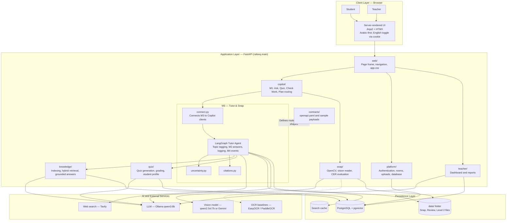

#### Component responsibilities

| Component | Responsibility |
|---|---|
| Browser UI | Student and teacher pages rendered with Jinja2 and HTMX |
| FastAPI application | Hosts the platform and feature modules |
| M1 — Copilot | Routes requests to the relevant student feature |
| M2 — Knowledge | Indexes learning materials and retrieves relevant passages |
| M3 — Tutor & Snap | Runs guided tutoring, citation checks, uncertainty checks, and image-based work review |
| M4 — Quiz & Profile | Generates and grades quizzes, tracks learning events, and maintains student learning data |
| M5 — Teacher | Presents class insights and manages teacher-reviewed replies |
| AI services | Provide language generation, vision interpretation, OCR baselines, and web search |
| Persistence | Stores indexed knowledge, platform records, study files, review data, and cached search results |
| API contracts | Document expected routes and JSON payloads |

### Module Ownership and API Contracts

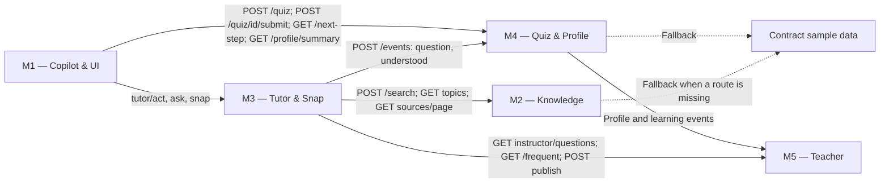

**Contract principle:** `contracts/openapi.yaml` and its samples define the expected routes and JSON structures between modules. The diagram records sample-data fallback paths where documented.

### Deployment Workflow

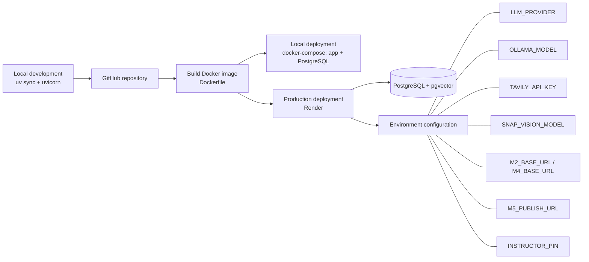

#### Deployment configuration

The source diagrams identify the following environment variables:

- `LLM_PROVIDER`
- `OLLAMA_MODEL`
- `TAVILY_API_KEY`
- `SNAP_VISION_MODEL`
- `M2_BASE_URL`
- `M4_BASE_URL`
- `M5_PUBLISH_URL`
- `INSTRUCTOR_PIN`

## Feature workflows

Every student and teacher feature, with the routes and modules it touches. (The same diagrams are also kept in one file: [docs/architecture.md](docs/architecture.md).)

### 1. Ask: Grounded Tutoring (Level 1)

**Goal:** Answer a student’s question using course knowledge and provide clickable source references.

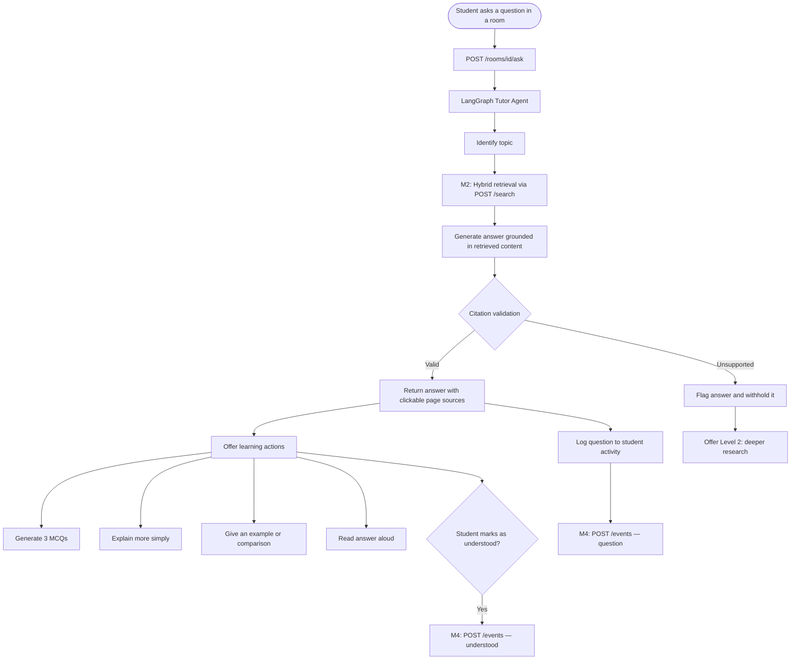

**Workflow notes**
- Level 1 uses M2 retrieval to ground the answer in course material.
- The citation check verifies that cited passages come from M2 and share words with the cited text.
- If support is insufficient, the answer is withheld and the student can choose deeper research.
- Questions and understanding events are logged for learning analytics.

### 2. Ask: Deeper Research (Level 2)

**Goal:** Research a topic on the web and create a study file with a user-selected length of 1–15 pages.

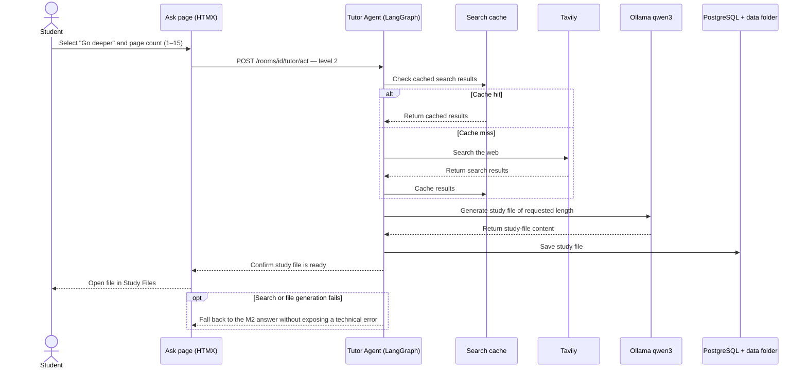

**Workflow notes**
- Search results are cached to reduce repeated searches.
- The generated study file is saved and made available through the Study Files tab.
- If search or file generation fails, the documented fallback is the M2 answer.

### 3. Guided Hints for Math and Code

**Goal:** Help students progress through a problem incrementally before showing the full solution.

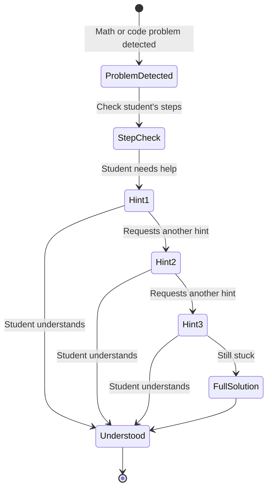

**Learning sequence:** Check the student’s work → provide up to three progressive hints → reveal the full solution only if needed.

### 4. Snap & Ask: Photo and Handwriting Analysis

**Goal:** Review a student’s handwritten work step by step, while asking for clarification when the image or text is uncertain.

```mermaid
flowchart TD
    A([Student uploads a photo or captures one with the device camera]) --> B[POST /rooms/id/vision/check-work]
    B --> C[OpenCV preprocessing]
    C --> C1[Perspective correction and deskew]
    C1 --> C2[Denoising and adaptive thresholding]
    C2 --> D[Detect line bounding boxes]
    D --> E[Vision model reads each line]
    E --> F{Confidence and readability check}
    F -->|Confidence below 0.6 or most lines are poor| G[Request clarification; do not judge the work]
    F -->|Sufficient confidence| H[Check each step]
    H --> I{Possible misread, crossed-out text, unclear sign, or mixed scripts?}
    I -->|Yes| J[Mark as "check" and ask one clarification question]
    I -->|No| K{Is the step correct?}
    K -->|Yes| L[Mark step as OK]
    K -->|No| M[Mark step as an error and box the incorrect line]
    M --> N[Provide up to 3 hints, one at a time]
    N --> O[Show the full step-by-step solution if needed]
    G --> P([Show result and next action])
    J --> P
    L --> P
    O --> P
```

**Workflow notes**
- Preprocessing uses OpenCV operations to improve image readability.
- The configured vision model may be Qwen2.5-VL or Gemini.
- Uncertain handwriting is not automatically judged; the student is asked to clarify.
- Results distinguish correct work, uncertain work, and errors.

### 5. Quiz

**Goal:** Generate topic-based quizzes, grade submissions, and use results to identify weak topics.

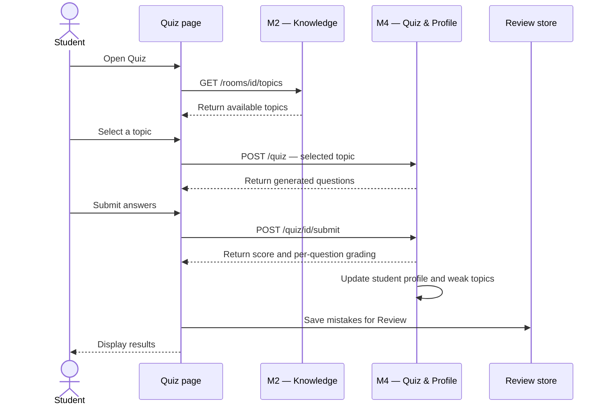

### 6. Review: Spaced Repetition

**Goal:** Revisit mistakes on a schedule and remove them from Review once they are consistently answered correctly.

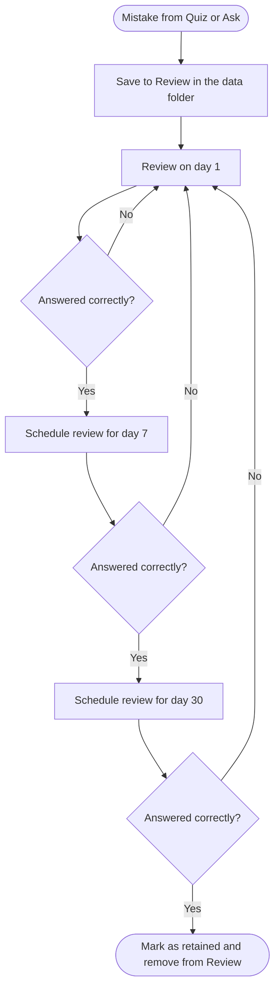

### 7. My Plan

**Goal:** Recommend a next learning action using the student’s history and weak topics.

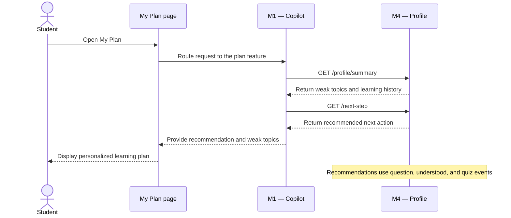

### 8. Copilot: Message Routing

**Goal:** Route each user request to the appropriate feature rather than treating every request as a general question.

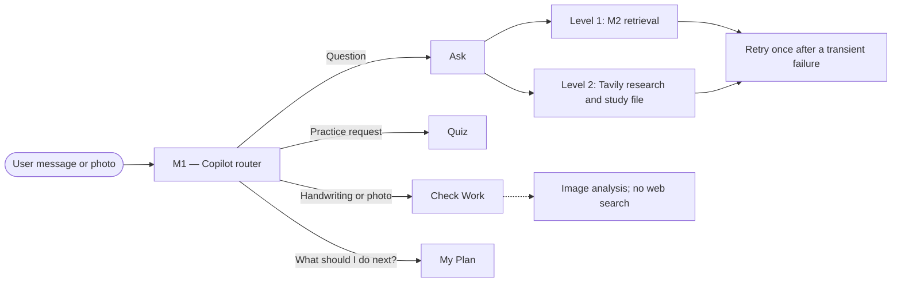

### 9. Rooms and Course Materials

**Goal:** Let teachers organize course content and give students a shared context for learning activities.

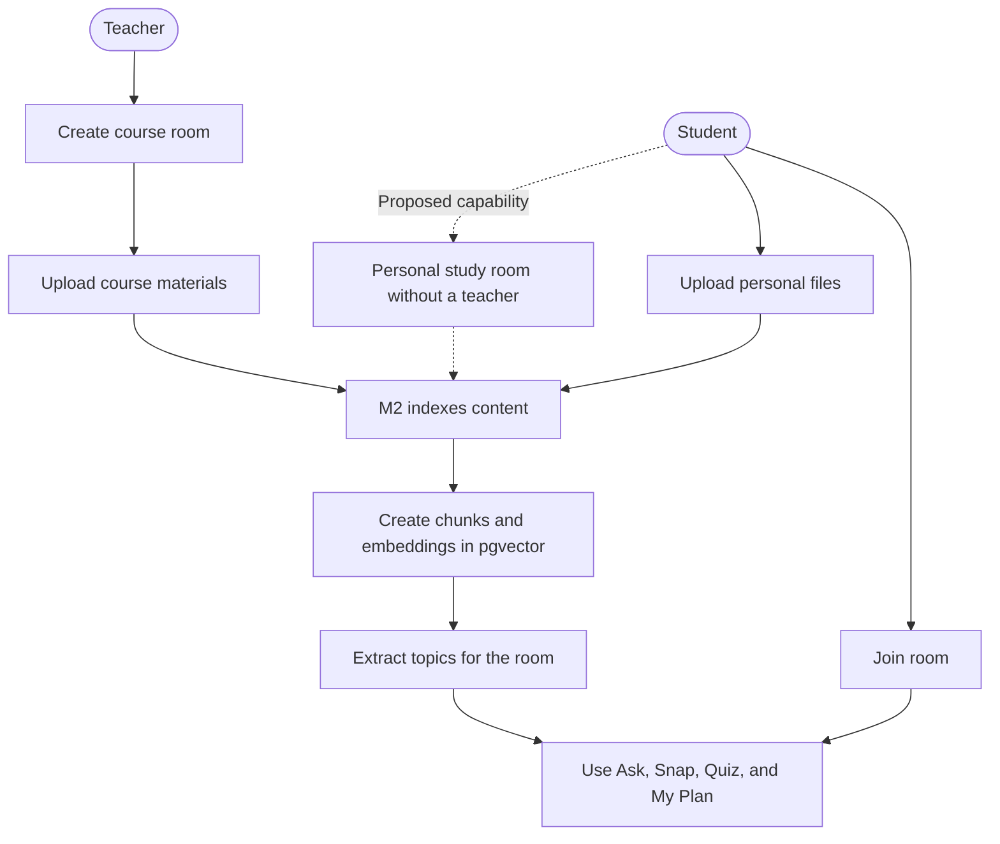

> **Status note:** The personal study room is marked as proposed in the source diagrams.

### 10. Study Files

**Goal:** Provide access to saved study materials and turn them into additional learning activities.

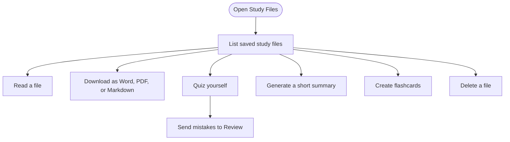

### 11. Teacher Dashboard

**Goal:** Turn student activity into class-level insights and let teachers review replies before publishing them.

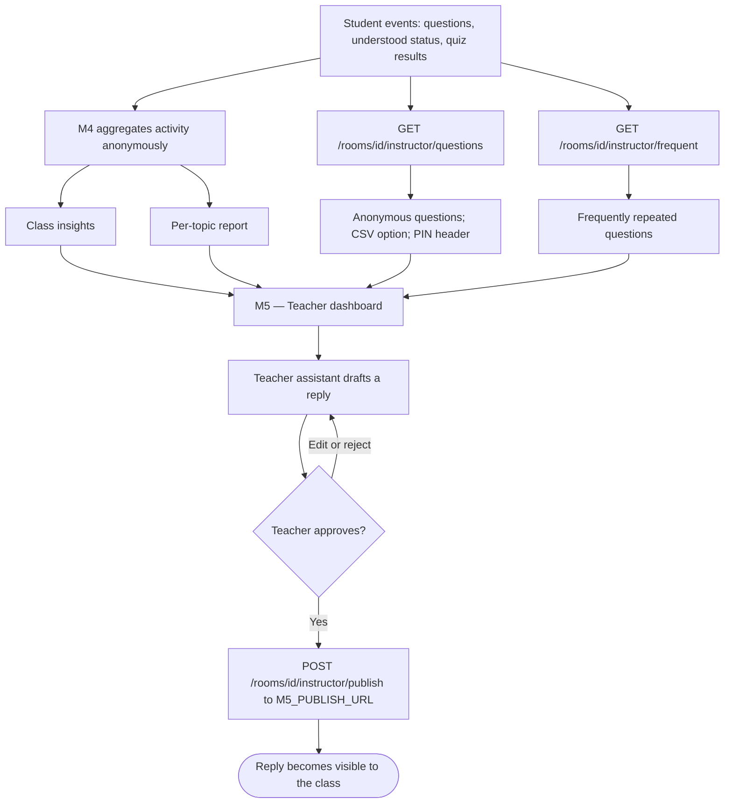

## The student pages

The site opens on `/` with every page in the top bar, in Arabic or English (the **EN / عربي** switch, kept in a cookie).

| Page | What it does |
|---|---|
| **Ask** `/chat` | A question about the room's material: grounded answer + clickable sources (the exact page) + 3 MCQ + "explain simpler / give an example / compare with ..." + read aloud. A math or code problem gets a step check, then **3 hints one at a time, then the full solution with steps**. Web research writes a study file of 1..15 pages. Topic chips filter the search. |
| **Snap** `/snap` | Photo (file or device camera) of a question or handwritten work: the text, then every step checked, the wrong line boxed on the page; wrong or unfinished work gets the 3 hints and the full solution. |
| **Study files** `/study` | Read, download Word / PDF / Markdown, quiz yourself, short summary, flashcards, delete. |
| **Quiz** `/quiz` | Pick a topic (M2) and take M4's quiz; scored by M4 (here until it exists); mistakes go to Review. |
| **Review** `/review` | Mistakes come back after 1, 7 and 30 days until they stick. |
| **My plan, Rooms** | M4's next step and weak topics; the rooms. |

M2 and M4 are called exactly as `contracts/openapi.yaml` says (`rafeeq/tutor/m2.py`, `rafeeq/tutor/m4.py`): M2 `/search`, `/rooms/{id}/topics`, `/sources/page`; M4 `/quiz`, `/quiz/{id}/submit`, `/next-step`, `/profile/summary`, `/events` (`question` and `understood`). Until their routes exist the pages use the agreed sample data and say so on screen.

## Configuration

Set these in `.env` (locally) or in the Render environment:

| Variable | Purpose |
|---|---|
| `LLM_PROVIDER`, `OLLAMA_MODEL` | Which LLM provider and model to use (default `ollama`, `qwen3:8b`) |
| `TAVILY_API_KEY` | Web search for Level 2 |
| `SNAP_VISION_MODEL`, `SNAP_READER` | Handwriting reader (`qwen2.5vl:7b`; `ollama` or `gemini`; baselines `easyocr`, `paddleocr`) |
| `M2_BASE_URL`, `M4_BASE_URL` | Where to reach M2 and M4 |
| `EVENTS_URL` | Where QuestionEvents are posted (M4) |
| `M5_PUBLISH_URL` | Where approved teacher replies are published |
| `INSTRUCTOR_PIN` | When set, required as a header on the instructor routes |
| `TUTOR_SAMPLE_FALLBACK=0` | Turn off the sample-data fallback |
| `RAFEEQ_CONNECT_M3=0` | Switch off the M3 connection (tests do) |
| `RAFEEQ_ALLOW_ANONYMOUS=1` | Development mode only (the tests set it): routes skip the login and room checks. Never on a real server |
| `SNAP_MARK_UNCERTAIN` | Reader marks what it cannot see (default 1) |

Level 2, Snap and Review data are kept in the git-ignored `data/` folder.

## M3 tutor API and the handwriting measurements

Room routes (agreed in `contracts/openapi.yaml`, tag M3): `POST /rooms/{id}/ask` (Level 1 or 2), `POST /rooms/{id}/vision/check-work` (photo), `GET /rooms/{id}/questions` (the student's own log), `GET /rooms/{id}/instructor/questions` (anonymous, `?format=csv`, `INSTRUCTOR_PIN` header when set) and `POST /rooms/{id}/instructor/publish` (to `M5_PUBLISH_URL`). Ask runs the LangGraph agent in `rafeeq/tutor/agent.py`: tag_topic, M2 answer, log, M4 event; Level 2: search (cached), study file, saved.

Handwriting: `rafeeq/snap/` is OpenCV (perspective, deskew, denoise, adaptive threshold), line boxes, a vision model per line (`SNAP_READER=ollama|gemini`, baselines `easyocr|paddleocr`). To measure it on your 20 REAL photos:

```bash
# photos in data/images/ named ar_01.jpg en_02.jpg math_03.jpg code_04.jpg
uv run python -m rafeeq.snap.init_gt                 # creates data/ground_truth.csv: fill the text column by hand
uv run python -m rafeeq.snap.evaluate --readers easyocr ollama --presets raw pre --debug   # CER with and without preprocessing, vision model vs baseline
```

`python -m rafeeq.snap.make_demo_set` makes 20 DEMO images (drawn text, not real handwriting) in `data/demo_images/` to check that the measuring works; do not report their numbers as results. Output goes to `results/` (`summary_cer.csv`, `results.csv`, `debug/`).

### How M3 is connected to the other members

- **M1 (Copilot, /snap, /app UI)**: `rafeeq/tutor/connect.py` (`connect_m3()`, called in `rafeeq/main.py`) plugs M3 into `rafeeq/copilot/clients.py`: `tutor_answer` (M2 retrieve, verified citations, `topic_id`), `check_work` (every step ok/check/error, the real box of the wrong line), `read_image` (OpenCV + vision model for `POST /snap`) and `record_event` (delivers the Copilot's QuestionEvent to M4). M1's UI at `/app` therefore shows live M3 answers instead of samples. `RAFEEQ_CONNECT_M3=0` switches it off (tests do).
- **M2**: `rafeeq/tutor/m2.py` calls `POST /search`, `GET /rooms/{id}/topics`, `GET /sources/page` exactly as in the contract; until they exist the agreed samples are used and labelled `sample`.
- **M4**: `rafeeq/tutor/events.py` posts the QuestionEvent (`question` / `understood`) to `EVENTS_URL`.
- **M5**: `GET /rooms/{id}/instructor/questions` (anonymous, no names or ids; `?format=csv`) and `POST .../instructor/publish` to `M5_PUBLISH_URL`.
- **The tutor agent in the green app** (`rafeeq/tutor/tutor_agent.py`, a LangGraph agent under M1's Copilot): Ask Rafeeq (`/app/rooms/{id}/study`) now offers, under every answer, the 3-question quiz, simpler / example / compare, and "go deeper" (Level 2: web search, a study file of N pages, saved). A study file has quiz, summary, flashcards and Word / PDF / Markdown downloads, and the room's files are listed in the **Study files** tab. A math or code problem gets 3 hints one click at a time, then the full solution; a photo gets every step coloured ok / not sure / wrong with one hint each. Everything goes through one contract route, `POST /rooms/{id}/tutor/act`. The old blue site (/chat, /snap, /study, /quiz, /review, /plan, /lab) was removed.
- **Class insights**: what students ask again and again (same topic, nearly the same words, no names) is shown to the teacher in Class insights (`GET /rooms/{id}/instructor/frequent`).

### M3 reliability: uncertainty, citations, routing, evaluation

- **Uncertainty** (`rafeeq/tutor/uncertainty.py`): a handwriting line that may be misread (the reader wrote `[?]`, crossed-out text, an unclear sign like `x ? 5`, noise, letters of two scripts inside one word) is never judged: it is `check` with one question for the student, and when the reader's confidence is below 0.6 or most lines are bad nothing is judged (`needs_clarification`, no model call). The reader marks what it cannot see through `SNAP_MARK_UNCERTAIN` (default 1; the CER evaluation turns it off).
- **Citations** (`rafeeq/tutor/citations.py`): every citation must be a passage M2 returned for this question, and the answer must share real words with its cited text (same script only, otherwise `unchecked`). An unsupported answer is withheld (`answer_flagged`) and Level 2 is offered.
- **Routing** (`rafeeq/tutor/agent.py`): handwriting -> check work (never the web); Level 1 -> M2 only; Level 2 -> Tavily -> study file. One retry at most for a transient failure (M2 down, network); a missing key or quota is never retried. A failed web search or file falls back to the M2 answer instead of an error.
- **Report**: `python -m rafeeq.snap.report --cer-from results/results.csv --cer-label "..."` (or `--run-cer` on your photos) writes `results/report.md` and `report.json`: CER with/without preprocessing, VLM vs OCR baseline, step-status accuracy, first-error localisation, hint relevance (keyword proxy), hint leaks, uncertainty handling, citation validity. Your own labelled cases go in `data/eval/work_cases.json` and `data/eval/questions.json`; a metric with no data says NOT RUN.
- **Adversarial tests**: `tests/test_adversarial.py` (blurry, dark, faded, rotated, upside down, cropped, tiny, blank, crossed out, ambiguous sign, mixed Arabic/English, incomplete, bad uploads, solution leaks, invented citations, retries and fallbacks).

## Evaluation results

Every AI part is scored by a script against a frozen test set (locked by a SHA-256 hash), so later results can be compared on the same baseline. Reports (`report.md`, `report.json`) are committed next to the code.

| Part | Result | Test set |
|---|---|---|
| Hybrid search | **100% Hit@5**, MRR 0.788 | 42 held-out questions |
| Handwriting reading (CER) | **0.53 → 0.13** after OpenCV preprocessing | vision model, raw vs preprocessed, 20 images |
| Step checking | **36 / 38** steps judged correctly; no hint leaked a solution | 14 test cases |
| Automated tests | **1,320+** pass, plus every sample checked against the API contract | `uv run pytest` |

> **Caveat.** The test sets are small and the handwriting images are synthetic, so these numbers show the pipeline works, not final accuracy. Re-measure on real photos (see above) before quoting them as results.

Planned: a results page for teachers that reads the same report files, and an automatic run on every code change.

## Cost

AI costs about **$0.44 per student per month** (a 30-student class with its teacher is about $13/month; 1,000 students about $436/month including story video). A student uses about 447k tokens a month, roughly $0.36 of LLM cost.

This is an estimate from prompt sizes and assumed usage; the app does not count tokens yet. Prices are from public pages, Oct 2026.

## Business model and market (proposed, to validate in pilots)

| Plan | Price | Includes |
|---|---|---|
| Teacher Free | EGP 0 | 1 class room, up to 30 students, AI tutor and quizzes, basic struggling-student view |
| Teacher Pro | EGP 199 / month | Unlimited class rooms, one-click lesson studio, video tools and exports |
| School & Centre | EGP 25 / student / month | Dashboards across every class, weekly parent reports, LMS and WhatsApp integration (main revenue) |

A month of Rafeeq per student costs less than one private group session (EGP 150–300). The beachhead is private learning centres and schools in Greater Cairo (about 2.2M of Egypt's 25.8M students are in private K-12 schools), then universities, training centres, online academies and corporate training. Growth path: teachers first through the free plan, then pilots with centres, then LMS/WhatsApp integrations and white-label versions.

**On-premise option** (for privacy and contract needs, not savings):

| Tier | Size | Estimated cost |
|---|---|---|
| Pilot | One school, up to ~300 students (RTX 5090, 32 GB) | $8–9k |
| Mid | 1,000–3,000 students (RTX PRO 6000, 96 GB) | $22–28k |
| Large | A whole school network | By quote |

Hosted AI costs about $436/month for 1,000 students, so a $22–28k server takes roughly 50–65 months to pay back. Hardware figures are estimates from public GPU prices and were not load-tested; Arabic answer quality with open models must be re-measured before promising it.

## Run the tests

```bash
uv run pytest
```

This also checks that every file in `contracts/samples/` matches the API contract in `contracts/openapi.yaml`.

## Deployment

Local development uses `uv sync` + `uvicorn`, or `docker compose` (app + Postgres). The same Docker image is deployed to Render with PostgreSQL + pgvector and the environment variables listed under [Configuration](#configuration). The deployment diagram is under [System architecture and deployment](#system-architecture-and-deployment).

## Project structure

```
rafeeq/
├── main.py          # starts the app, plugs in every router
├── samples.py        # load_sample(name) — read an agreed example JSON
├── web/               # page frame, nav, the one app.css
├── platform/          # login, rooms, file uploads, database
├── copilot/           # routes a message to ask / quiz / check_work / plan
├── snap/               # photo → text (OpenCV + a vision-language model)
├── knowledge/          # indexing and search (hybrid retrieval, grounded answers, evaluation) -> knowledge/README.md
├── tutor/              # grounded answers, handwriting check
├── quiz/                # quiz generation, grading, student profile
└── teacher/            # teacher dashboard and reports
contracts/
├── openapi.yaml        # every route, and the JSON shape it sends/receives
└── samples/             # one real example per JSON file
tests/                   # automated checks
docs/
├── architecture.md      # feature workflows, architecture and deployment diagrams
├── images/              # slides from the capstone presentation used in this README
└── knowledge/           # M2 evaluation reports (historical, written in the standalone project)
```

## Contributing

See [CONTRIBUTING.md](CONTRIBUTING.md) for the branch workflow and how the team is organized.

## Status

In active development for the NTI AI capstone.

## Team

A five-member team built this for the NTI AI course capstone, Education domain.
